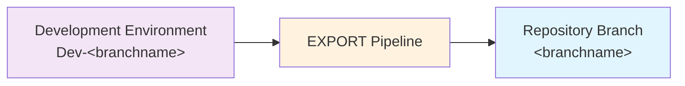

# Exporting Changes



The `EXPORT` pipeline for each repo takes the state of the solution(s) (and other assets like data if you include them) in your development environment, and exports them to the source control repo.

## Before You Export

- Save and publish the intended maker changes, and confirm the configured solutions contain all required components.
- Check the selected branch and its development Dataverse URL. EXPORT writes to that branch directly; it does not open a pull request.
- Coordinate with other makers using the same development environment. All configured solution changes are exported, not just the caller's changes.
- Ensure the automation identity can export solutions, update solution versions, and push to the branch. Branch protection may require an integration branch instead of exporting directly to `main`.
- Review data hooks before running them: exported records become repository contents and must not contain secrets or inappropriate personal data.

> [!TIP]
> Export frequently; there is no need to wait until you are ready to deploy. Each export
> captures your work in source control and creates a useful history.

Exporting takes all changes to the configured solutions (and other assets) from the
associated environment. There is no method to select individual changes, so coordinate
with other makers sharing that environment.

> [!NOTE]
> **Advanced: branch-specific development targets.**
>
> ALM4Dataverse uses a convention-based approach to associate each branch with a development environment:
>
> - **Azure DevOps**: looks for a service connection named `Dev-<Build.SourceBranchName>` (e.g. `Dev-main`). A branch such as `feature/customer-import` uses its last path component: `Dev-customer-import`.
> - **GitHub Actions**: uses the GitHub environment named `Dev-<branchname>` (e.g. `Dev-main`).
>
> GitHub uses the full branch name, so that same feature branch defaults to
> `Dev-feature/customer-import`. An explicit action `environment-name` can override
> credential resolution; update the job environment and OIDC credential consistently.
> See [branching strategies](branching-strategies.md).

## Run EXPORT

**Azure DevOps:**

1) Navigate to the **Pipelines** area of your AzDO project.
2) Select the **All** tab and navigate to the folder with the same name as your repo.
3) Select the `EXPORT` pipeline and click **Run pipeline**.
4) If you're using multiple branches, select the correct branch. Otherwise it defaults to `main`.
5) Enter the commit message.
   This is the message that will be logged in source control history. If you include ticket numbers in `#1234 #2345` format, the changes will also be shown against those tickets in the 'Development' section.
6) Click **Run**. The view will switch automatically to show progress. Wait until it is shown as successful.

**GitHub Actions:**

1) Navigate to the **Actions** tab of your repository.
2) Select the **EXPORT** workflow and click **Run workflow**.
3) If you're using multiple branches, select the correct branch. Otherwise it defaults to `main`.
4) Enter the commit message and click **Run workflow**.
5) Select the running workflow run to follow its progress. Wait until it is shown as successful (green checkmark).

## What Happens

1. Dependencies are installed and the application identity connects to the development environment.
2. `preExport` hooks run.
3. Each configured solution is exported to `solutions/<unique-name>`, including unpacked canvas-app content. Existing source is replaced by the export.
4. Solution changes are compared with the prior source; changed solutions have their versions updated in both source and Dataverse.
5. `postExport` hooks run, including configured data exports.
6. All working-tree changes are committed with the supplied message and pushed. Azure DevOps uses the requesting user's name/email; GitHub uses the triggering actor and a GitHub noreply address.

No detected changes means no new commit. Data-only hook changes can create a commit without incrementing any solution version.

> [!NOTE]
> **Advanced: triggering BUILD.** On Azure DevOps the push triggers BUILD. On GitHub,
> EXPORT explicitly sends a repository-dispatch event after pushing, because a push made
> with `GITHUB_TOKEN` does not normally trigger another push workflow. BUILD checks out
> the exact exported commit; the BUILD caller must exist on the default branch.

### Version Increments

| Detected solution change | Version effect | Example |
| --- | --- | --- |
| Additive change, or first export with no prior source | Increment revision | `1.2.3.4` becomes `1.2.3.5` |
| Non-additive component change | Increment minor and reset build/revision | `1.2.3.4` becomes `1.3.0.0` |
| No source changes | No increment | Version remains unchanged |

This matters during deployment: matching major/minor versions permit updates; a different major/minor can require an upgrade that removes obsolete components. Detection is based on solution component comparison, not a guarantee that a business change is backward-compatible. The CI build/release identity is separate from each solution's version.

## Verify And Continue

Review the resulting commit for unintended solution/data changes, then check [BUILD](building-releases.md).

> [!WARNING]
> If the push fails because the branch advanced, do not force-push over others' changes.
> Coordinate the export/source changes, synchronize the development environment as
> appropriate, and rerun. EXPORT may already have updated Dataverse versions before a
> later Git failure. See [importing changes](importing-changes.md) for safe synchronization.

## Export Processing and Validation

Managed and unmanaged packages are exported in parallel by default, including
both packages of the same solution. Unpacking, change detection and version
updates still run in the configured solution order.

In the TTEC Digital fork, custom validation can start after a solution is
unpacked while later exports are still running. This is used only when the
standard fork post-export hook is first and no legacy `PostExportScript` is
configured. Otherwise validation runs in the post-export hook, after exports.
Custom hooks, data exports, Power Pages downloads and Synapse exports keep their
existing order.

The defaults in `alm-config.psd1` are:

```powershell
export = @{
  parallel = $true
  maxParallel = 2
  maxConcurrentOperations = 4
}
validation = @{
  parallel = $true
  maxParallel = 4
}
```

The defaults allow up to two concurrent package exports and up to four concurrent
custom rules, subject to a shared limit of four operations. The limit also applies to version updates and
validation run by post-export hooks. Each running rule counts as one operation;
custom hooks are not limited by these settings.

Set `export.parallel = $false` for sequential exports, or
`validation.parallel = $false` for sequential rules. These settings are
independent. The parallelism limits accept integers from `1` to `8`. See
[ALM Configuration](../config/alm-config.md#export-processing) for the full settings reference.

Validation still runs for unchanged solutions. Allowed dependencies include
configured external dependencies and preceding solutions only. Error, warning,
disabled and rule/component override behaviour is unchanged. Results are reported
in rule order, not completion order. Custom EXPORT validation is separate from
the BUILD PAC checker.

## Export Logs

Live messages identify the solution and phase, with custom rule events formatted
as `[Solution][Validate:Rule]`. Detailed export and validation output is grouped
by solution and phase. Every line of a finding identifies its solution.

Rule execution failures print the actual error and its exception context directly
in the standard log, with `[Solution][Validate:Rule]` on every line. Detailed
artifacts are additional diagnostics, not a replacement for the error in the log.

The final summary reports validation status, finding counts and available
timings for each solution, including on failure. Export duration measures elapsed
time, not the sum of concurrent export times. `NotReported` means no validation
summary was produced; it does not mean validation passed.

Detailed logs, findings, rule timings and `summary.json` are retained under
`export-logs` in the artifact staging directory. Azure DevOps publishes the
`export-logs` artifact, and GitHub Actions uploads it even if export fails.
Local runs retain the same files, including logs from rules that produce no
output or fail.

For local performance measurements, `pipelines/scripts/export.ps1 -PassThru`
returns total elapsed seconds and export/validation timings. Authentication and dependency
installation are outside that measurement.

## Runtime Measurement

A single before/after pair on 2026-10-12 measured the complete EXPORT script for
`TestSolution1` and `TestSolution1RuntimeDependencies`, not just individual rules:

| Configuration | Total elapsed time |
| --- | --- |
| Merge-only baseline, before the export improvements | 162.052 seconds |
| All export improvements enabled with default concurrency settings | 82.021 seconds |
| Reduction | 80.031 seconds (49.4%) |

Both runs used the same populated solution sources and the same Dataverse
environment, with `Rnwood.Dataverse.Data.PowerShell` 3.0.3 and PAC 2.7.4. The
baseline was the fork before these export and validation improvements. The
improved run used the default concurrency settings shown above.

Each run reported the same two fixture findings. Exported sources and environment
solution versions stayed unchanged. Git writes and version updates
were disabled for the measurement; validation ran in warning mode. Timing
included solution exports, source processing, post-export hooks and validation,
but excluded authentication, dependency installation and final Git commit/push.

> [!NOTE]
> This is one measured pair, not an average or median. The improved run followed
> the baseline, so cache warmth and Dataverse service variability can affect the
> comparison. These test solutions primarily contain tables, columns and lookup
> relationships; apps, flows, large datasets and custom hooks can have different
> runtime characteristics. The result is not a performance guarantee.

## Viewing Exported Changes

**Azure DevOps:**

1) Navigate to **Repos** in Azure DevOps and select the correct repo and branch.
2) Switch to the **History** view.
3) Each commit is displayed with its message. Click a commit to see the full set of changes.

**GitHub:**

1) Navigate to your repository and select the correct branch.
2) Click **Commits** (shown above the file list).
3) Each commit is listed with its message. Click a commit to see the full diff.
