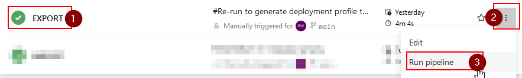
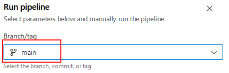
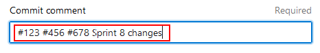
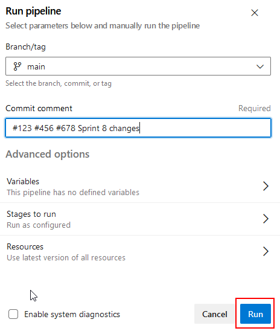
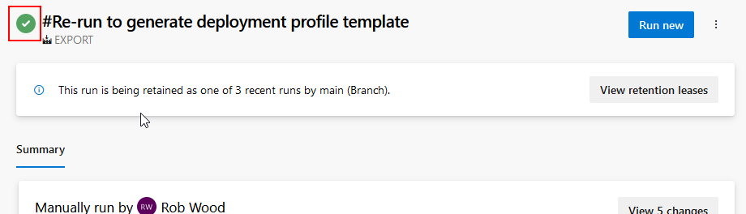
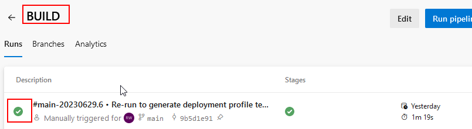

# Making and Exporting Changes

A) **Identify branch and development envt**
   In an advanced scenario, there will be multiple branches ongoing for development. Each branch has it's own development environment. Make sure to understand which branch and therefore development environment you need to use.

   In a simple scenario, there is usually only one branch: "main" and associated DEV environment.

B) **Make the changes in the DEV environment.**
   - Dataverse solutions: Use the standard maker portal etc. Remember to add new components to the solution.
   - Dataverse config/reference data: Edit/add/delete the records as required using any standard methods.
   - Portals: Use the standard maker portal etc. Make sure to associate records with the correct "website" record.

   > **:warning: Important**
   >
   > If you add a new solution, data set (or new table/column that needs to be managed within) or portal as part of development, [the new component for ALM](/Setup-and-Configuration/Per-Component-Setup).

C) **Test your changes!** 
   The DEV environment should be fully functional and you don't need to deploy your changes elsewhere before your initial testing.

D) **Export changes**
   > **:warning: Important**
   >
   >If working in the same development environment as other developers, make sure to synchronise on the best time to do this. All changes in the environment get exported at the same time. When team is mid-sprint changes should be exported at least daily and it's ok if what's exported contains half-complete work - but try make sure there isn't major breakage that will block testing.

   

     
<strong>Expand to see steps for Azure DevOps</strong>

   1) **Find "EXPORT" pipeline and pick the option to run:** 

      

   2) **Select the correct branch (see note above):**

      

   3) **Enter commit comment:**
      The comment should identify the reason the changes are being made and all affected work item numbers.

      
      
      > **:warning: Important**
      >
      >If working in the same development environment as other developers, see above note and make sure to enter their work item number too.

   4) **Accept and run:**

      

   5) **Monitor for successful completion:**
      Check the process completes with no errors.
      
      

      Some quality checks occur during this process and any violations will cause the pipeline to fail with an detailed error. Fix the problem in the DEV environment and try again!
      
   6) **Monitor BUILD pipeline:**
      Each change that is committed triggers the BUILD pipeline.
      Make sure that the run completes successfully.

      

   7) **The build version number is displayed:**
      This is the version of the product that must be deployed in order to see/test all the changes.

      
   

   

     
<strong>Expand to see steps for GitHub</strong>

   1) **Find "EXPORT" workflow and pick the option to run:** 

      
   2) **Select the correct branch (see note above):**

      

   3) **Enter commit comment:**
      The comment should identify the reason the changes are being made and all affected work item numbers.

      
      
      > **:warning: Important**
      >
      >If working in the same development environment as other developers, see above note and make sure to enter their work item number too.

   4) **Accept and run:**

      

   5) **Monitor for successful completion:**
      Refresh and check the process completes with no errors.
      
      

      Some quality checks occur during this process and any violations will cause the pipeline to fail with an detailed error. Fix the problem in the DEV environment and try again!
      
   6) **Monitor BUILD workflow:**
      Each change that is committed triggers the BUILD workflow.
      Make sure that the run completes successfully.

      

   7) **The build version number is displayed:**
      This is the version of the product that must be deployed in order to see/test all the changes.

      

   
 
F) See [release and deployment process](/Processes/Release-Deployment) for the process to apply the changes to environments.
