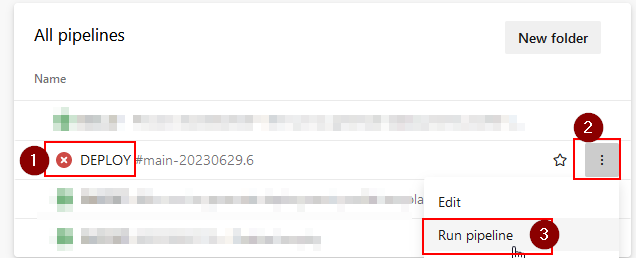
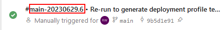
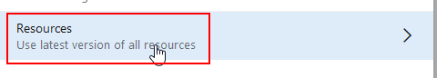
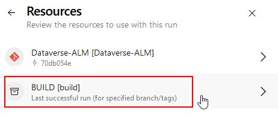
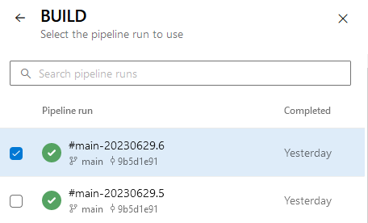
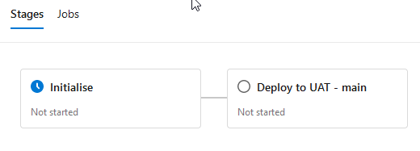
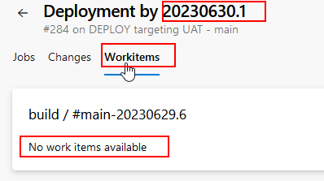

# Release and Deployment Process

To create a release (a version that will be taken from BUILD and used to deploy to one/several environments):

## Creating a new DEPLOY run

The BUILD process runs every time a change is made. By default when this completes this will trigger the DEPLOY process to start, so you don't need to create a run yourself. The approval rules on the first environment will dictate if it actually starts to deploy immediately or not.

   

     
<strong>Expand to see steps for Azure DevOps</strong>

A) **Choose the option to create a new run the DEPLOY pipeline**

   

B) **Select correct branch**
   In an advanced scenario there are several branches ongoing, each with their own test environments. Make sure to select the correct branch:

   

D) **Select the correct BUILD version:**
   By default, the most recent successful build for the branch will be selected. This is not always the version that you will want to deploy (for instance if you know more recent builds contains changes you don't want to deploy yet).
   
   Select the correct build version using "Resources":

      

   then BUILD:

   

   Then select from the list.   The version number show in the list match that shown when the BUILD job completes.

   

D) **Accept and run the job.**

   

     
<strong>Expand to see steps for GitHub</strong>

A) **Choose the option to create a new run of the DEPLOY workflow**

B) **Select correct branch**
   In an advanced scenario there are several branches ongoing, each with their own test environments. Make sure to select the correct branch:

D) **Enter the run ID for the correct BUILD version:**
    The latest is not always the version that you will want to deploy (for instance if you know more recent builds contains changes you don't want to deploy yet).

D) **Accept and run the job.**

## Viewing an existing DEPLOY run

   

     
<strong>Expand to see steps for Azure DevOps</strong>

A) **Deployment for each configured environment**
   Once a run is created, the DEPLOY pipeline will display a stage for each environment that is configured for the branch. This shows the deployment status for this build.

   

   Each environment can have different approval rules to control which environment are pre-requisites (deployment must have been done their first), who can approve deployment and time windows when deployment can occur. Deployment will not start until these rules are satisfied (if any). See [environment setup info](/Setup-and-Configuration/Per-Env-Setup) for details.

   Once deployment has been attempted, results will be shown against the stage and you can click to see logs.

   If there is any failure, you can retry the deployment for that environment using "Rerun failed jobs" action.

   

     
<strong>Expand to see steps for GitHub</strong>

A) **Deployment for each configured environment**
   Once a run is created, the DEPLOY workflow will display a stage for each environment that is configured for the branch. This shows the deployment status for this release.

   With the non-free Github tiers only, each environment can have different approval rules to control which environment are pre-requisites, who can approve deployment and time windows when deployment can occur. Deployment will not start until these rules are satisfied (if any). See [environment setup info](/Setup-and-Configuration/Per-Env-Setup) for details.

   Once deployment has been attempted, results will be shown against the stage and you can click to see logs.

   If there is any failure, you can retry the deployment for that environment using "Rerun failed jobs" action.

## Release and Deployment Notes

> **:warning: Important**
For this process to identify the correct work items, it is critical that when changes are made, they are associated with the relevant work items. [See the exporting changes process](/Processes/Exporting-Changes) for details.

### Release (BUILD) notes
Release notes show the implemented work items since the last (BUILD) for that branch.

   

     
<strong>Expand to see steps for Azure DevOps</strong>

You can see this list by opening a run of the BUILD pipeline and looking at "Related work items".

This is not normally the list that want to use. Deployment notes are usually what users are interested in.

   

     
<strong>Expand to see steps for GitHub</strong>

TBC

### Deployment notes for a given environment ##

Deployment notes show the implemented work items for every BUILD in between the last one which was successfully deployed to a given environment and the one that has just been deployed (so the new changes that users of that environment will see).

   

     
<strong>Expand to see steps for Azure DevOps</strong>

You can get this list by navigating to "Pipelines" > "Environments" > environment name and opening the relevant deployment item (BUILD number is displayed).

   

     
<strong>Expand to see steps for GitHub</strong>

TBC

