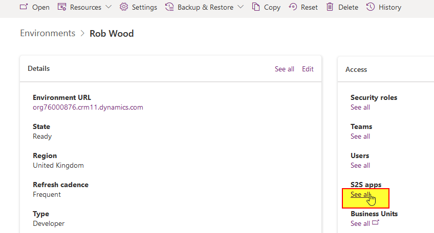
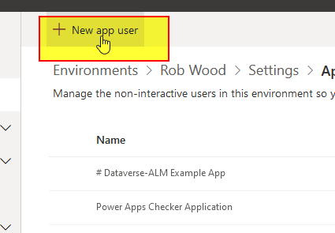
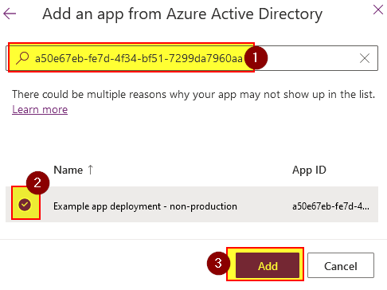
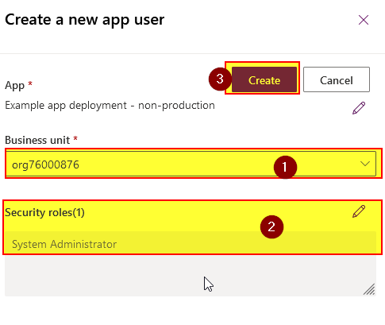
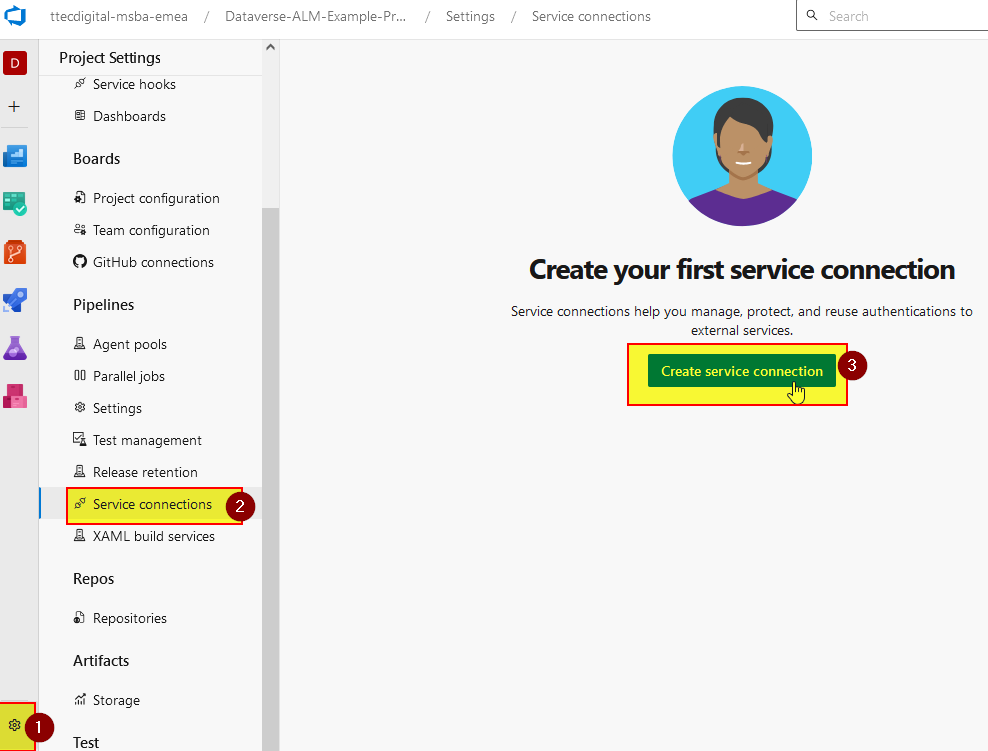
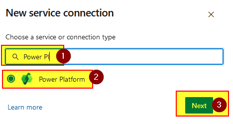
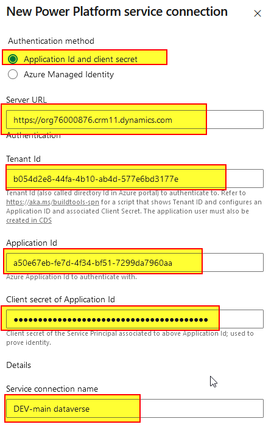
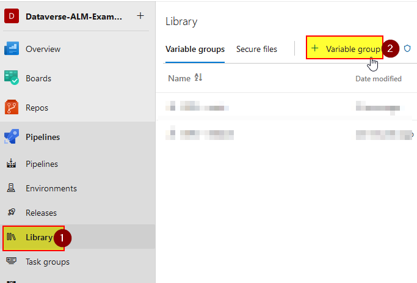
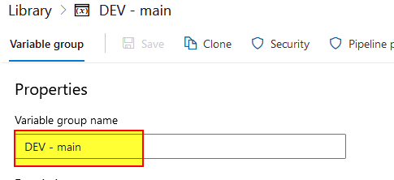

# Per-Environment Setup

Each Dataverse environment must be set up separately and registered with Azure DevOps.

DEV environments must have the name  `DEV - <branchname>` (Azure DevOps) `DEV_<branchname>` (Github). The default branch name is usually `main`. It is recommended to include the branch name for all other non-prod environments too.

**Ensure [per branch setup](/Setup-and-Configuration/Per-Branch-Setup) has been completed first.**

## A) Deployment Service Principal

See [per repo setup](/Setup-and-Configuration/Per-Repo-Setup) for details on registering the service principals required. This must be completed first.

> **:warning: Important**
> 
> See the note in the above about prod vs non-prod segregation.

1) In the Power Platform admin centre environment settings for the environment, select "S2S apps":

  

2) Select the option to create a new app user:

      

3) Select the service principal by searching for it using the app ID:

   

4) Select the root BU of the environment (normally named same as the URL when it was created) and "System Administrator":

   

### Azure DevOps Config

1) In Azure DevOps project settings, navigate to "Service Connection" and select the option to create new:

   

2) Select "Power Platform" connection type:

   

3) Enter the environment URL, the details that were copied above, and a name (should include the environment name):

   

### GitHub Config

Basic: 

Under `Settings > Secrets and Variables > Actions` create the following:

Enterprise: 

Create the variables (or secrets if noted) listed below at `Settings > Environments > <env name> > Secrets and Variables`. They do not need to be prefixed with `<envname>_`. 

| Type     | Name                              | Description                   |
|----------|-----------------------------------|-------------------------------|
| Secret   | `<envname>_DATAVERSECLIENTSECRET` | The secret for the SP         |
| Variable | `<envname>_DATAVERSEAPPLICATIONID` | The application ID for the SP |
|Variable | `<envname>_DATAVERSETENANTID` | Tenant ID |

## B) Environment variables

### Azure DevOps

1) Navigate to "Pipelines" > "Library" and select the option to add a variable group:

   

2) Set the name of the variable group to exactly `<env name> - <branch name>`.
   > **:warning: Important**
   > 
   > The development environment for each branch must have use the name `DEV`.
   
   e.g. for the DEV env for `main` branch (the default), the name to use is `DEV - main`

   

   Other environments can use any names.

3) Add variables as per the table below and then save the variable group.

4) Add an exclusive lock rule.

5) Add approval and business hours rules as required.

6) Grant "Project - Project administrators" group "administrator" level access to the variable group.

7) Create an "Environment" with same name. Grant "Project - Project administrators" group "administrator" level access.

### Github

#### Github basic:
Under `Settings > Secrets and Variables > Actions` create the variables (or secrets if noted) listed below ensuring they are prefixed with `<env name>_`.

Environment protection rules are not possible with Github basic. Take care to ensure deployments will not occur automatically. (TBC how)

#### Github pro/enterprise
Create the variables (or secrets if noted) listed below at `Settings > Environments > <env name> > Secrets and Variables`. They do not need to be prefixed. 

Environment protection rules can also be set here to control approval. (TBC)

### Variables to create

**For GitHub add prefix `<envname>_` to all of these if registering at repo level (the default).**

| Variable name                       | Value                                                                                                                                                                                                                                                                                                                                                                                     |
|-------------------------------------|-------------------------------------------------------------------------------------------------------------------------------------------------------------------------------------------------------------------------------------------------------------------------------------------------------------------------------------------------------------------------------------------|
| `DataverseServiceConnectionName`    | The name of the AzDO service connection to use when connecting to this env                                                                                                                                                                                                                                                                                                                |
| `DataverseURL`                      | URL of this environment                                                                                                                                                                                                                                                                                                                                                                   |
| `DATAVERSESERVICEACCOUNTUPN`        | UPN of AAD account that will own connections and activate Power Automate Flows                                                                                                                                                                                                                                                                                                            |
| `DATAVERSESERVICEACCOUNTPASSWORD` (secret)  | Password for AAD account above. Required if auto connection creation/mapping is configured.                                                                                                                                                                                                                                                                                               |
| `DATAVERSESERVICEACCOUNTTOTPSECRET` (secret) | MFA TOTP secret for AAD account above. Required if auto connection creation/mapping is configured and account requires MFA for login.                                                                                                                                                                                                                                                     |
| `DATAVERSECONNREF_<name>`           | Connection IDs to use for each connection reference.  Connections must be created by logging in interactively and then shared with the Service Principal configured in the AzDO Service Connection for the environment that is used for deployment or configured to be created/mapped automatically - [See here](./Per-Component-Setup/Dataverse-customisations-and-solutions.md) |
| `DATAVERSEENVVAR_<name>`            | Value to use for each environment variable.                                                                                                                                                                                                                                                                                                                                               |
| `PORTALCONFIG_<name>`               | Value to use for each portal config item.                                                                                                                                                                                                                                                                                                                                                 |

