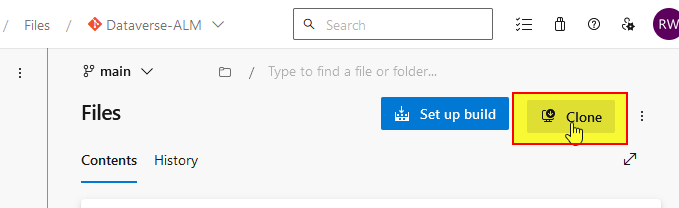
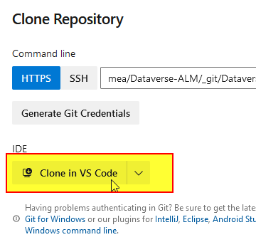
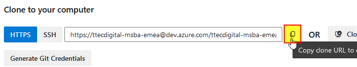
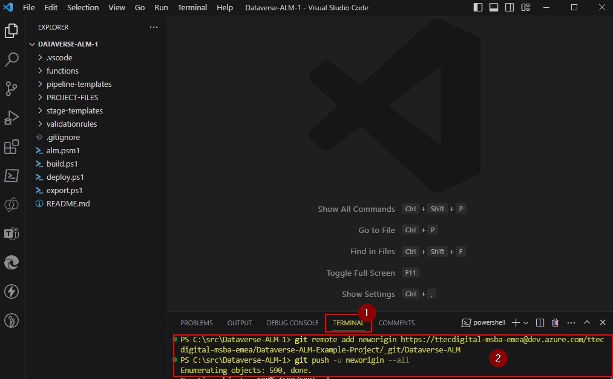

# Per-project setup

This setup is required once per target AzDO project. Multiple repos in the same project can/will share what is installed here.

## A) Copy this repo into the target project

> **Why like this?**
>
>  Doing it this way allows updates to downloaded easily in future as well as tracking and merging any project/customer specific customisation that are made.

1) Open the repo: [https://dev.azure.com/ttecdigital-msba-emea/_git/Dataverse-ALM] and select the "Clone" action:

   

2) Select the option to clone in VS Code:

   

3) Select a folder where the workspace folder will be created.

4) Wait for the clone to finish and then accept the option to open the folder in VSCode

5) In the target AzDO or GitHub, navigate to the "Repos" view in the target project (the project you want to add the ALM to) and select the option to create a new repo:

6) Enter name `Dataverse-ALM` unselect the options to create `README` and `.gitignore` before pressing "Create".

   > **:warning: Important**
   >
   > The name is important. Don't change. 

7) Copy the clone URL:

   

   

8) Back in VSCode. Enter the following in the terminal window and check it completed successfully:

    > **:warning: Important**
    >
    > Substitute the URL for the clone URL you copied.

   ```powershell
   git remote add neworigin https://ttecdigital-msba-emea@dev.azure.com/ttecdigital-msba-emea/Dataverse-ALM-Example-Project/_git/Dataverse-ALM  
   git push -u neworigin --all
   ```

   

## B) Install Dependencies (Azure DevOps only)

1) Install [Power Platform Build Tools Azure Devops Extension](https://marketplace.visualstudio.com/items?itemName=microsoft-IsvExpTools.PowerPlatform-BuildTools) into the target project.

## What's next?

Setup each repo - [Per-repo setup](Per-Repo-Setup.md)