# Per-Repo Setup

**Ensure [per project setup](/Setup-and-Configuration/Per-Project-Setup) has been completed first.**

Azure DevOps project can have several source control repos. Each repo can store one product of the project, or one seperately developed component of that product.

Each repo needs sepearate setup for ALM if they contain Dataverse components/data/etc.

## A) Create service principals for Dataverse management

Service principals are used by Azure DevOps to connect to the Dataverse environments and separate per product.

> **:warning: Important**
>
> It is best practice to use separate service principals for production vs non-production environments.

   - `<name of product> deployment - non-production`
   - `<name of product> deployment - production`

**For each service principal:**

> **Note**
>
> These steps may need to be performed by an AAD admin depending on the settings that are in place in the tenant.

1) Navigate to App Registrations at https://entra.microsoft.com/ and select the "New Registration" action:

   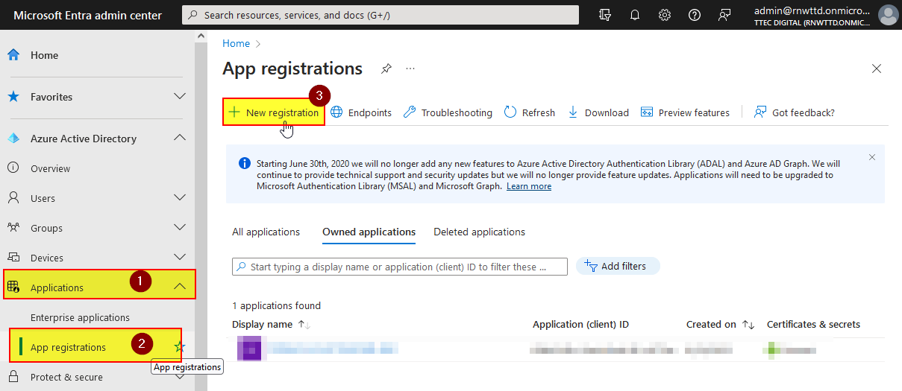

2) Enter the name and continue:

   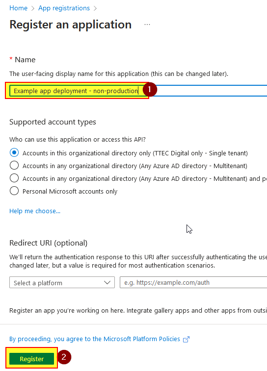

3) Copy the application and client ID from the overview page and keep them:

   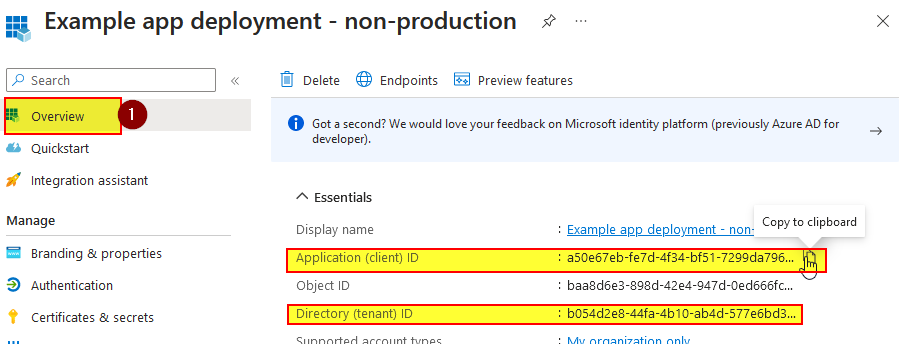

4) Navigate to "Certificates & Secrets" and select the action to create a new client secret:

   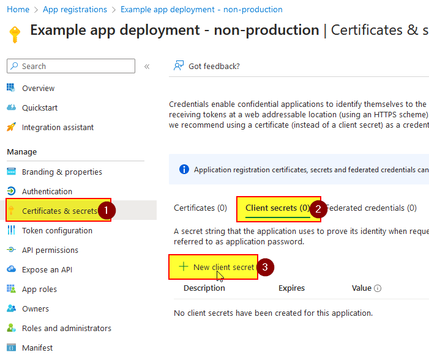

5) Enter the name as pictured (to help understand where this secret is being used) and continue:

   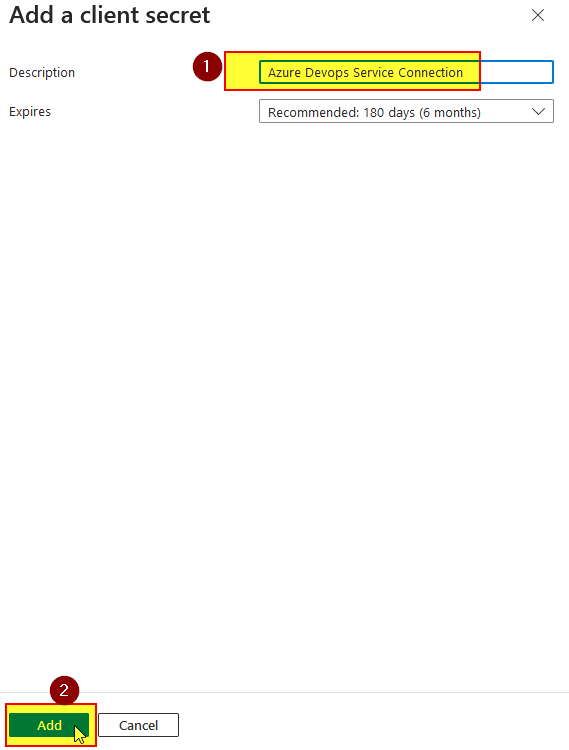

6) Copy the secret and store it securely:

   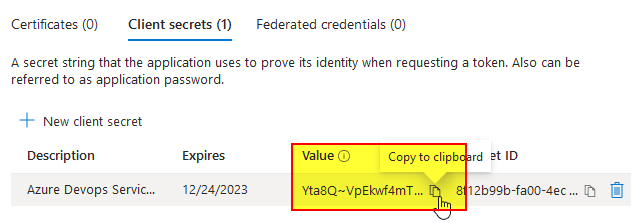

   > **:warning: Important**
   >
   > Copy "Value" and not "Secret ID"

   > **:warning: Important**
   >
   > This secret will give Sys Admin level access and so MUST be stored/shared securely.

7) Select "API permissions" and "Add a new API permission":

   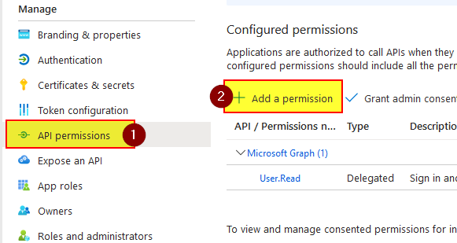

8) Select "PowerApps-Advisor":

   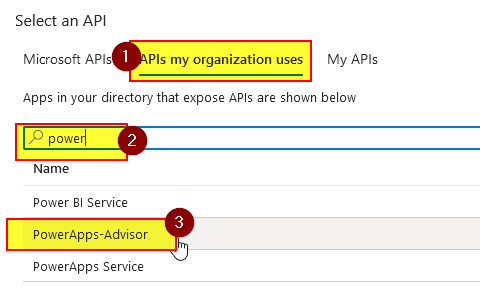

9) Select "Application permission":

  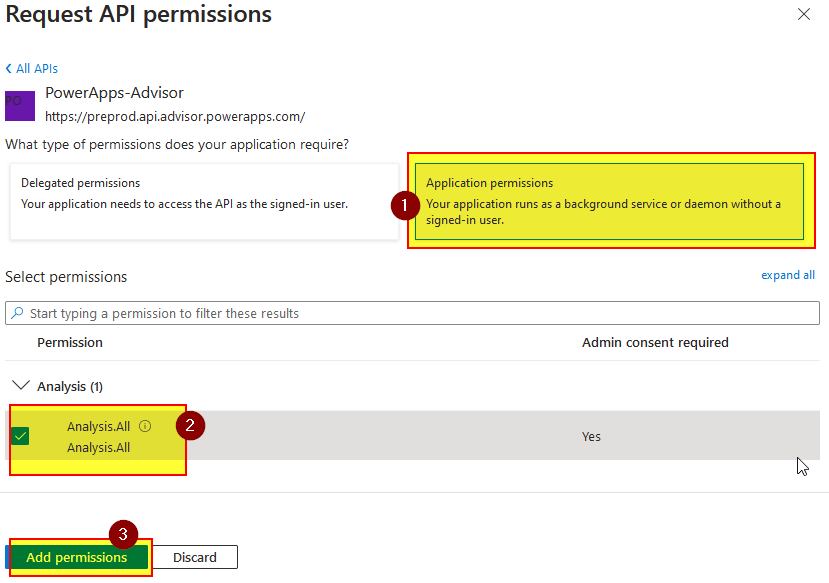

10) Grant (or get an admin to grant) consent:

   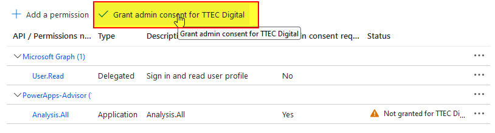

## B) Grant permission to Pipelines build service - Azure DevOps only

**Pipelines needs to be given permission to commit to the repo.**

1) In the target Azure DevOps project select "Repos" and "Manage Repos":

   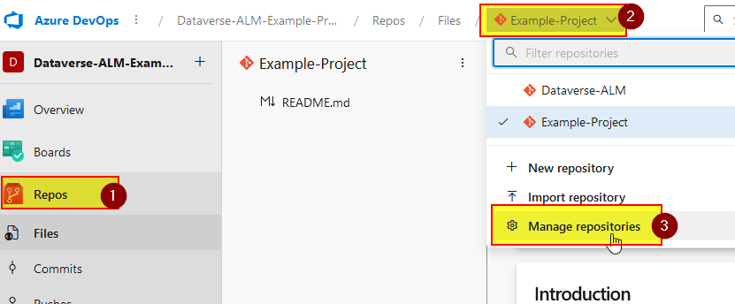

2) Select the target repo:

   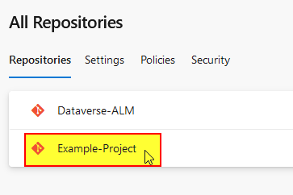

3) Grant the "Contribute" permission to the use with the name "&lt;project name&gt;-Project Build Service (&lt;org name&gt;)":

   

## C) Copy config files

1) In the `ttecdigital-msba-emea` Azure DevOps organisation, navigate to Repos and select the Dataverse-ALM repo then select the option to download `PROJECT-FILES` folder as a zip:

  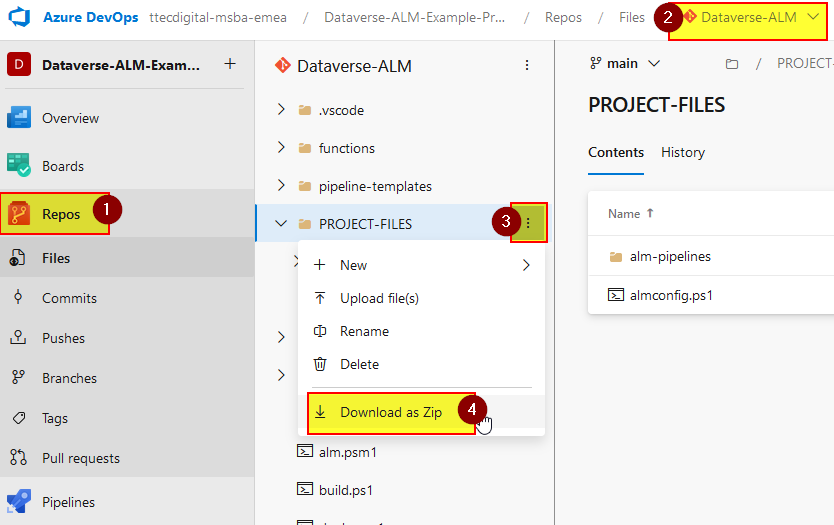

2) Expand the zip file

3) Open the target repo and select the "Clone" option:

  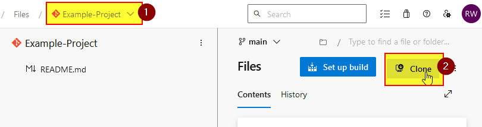

4) Select the "Clone in VS Code" action:

   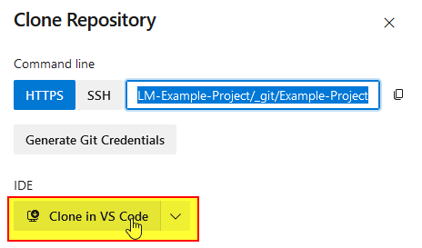

5) Select the local folder where the workspace will be created and accept the option to open the workspace once the download completes.

6) Right click in the Explorer window and select the option to open in Explorer:

   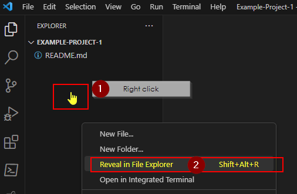

7) Copy all thes extracted file into the workspace folder (do not copy the `PROJECT_FILES` folder itself, only the contents):

   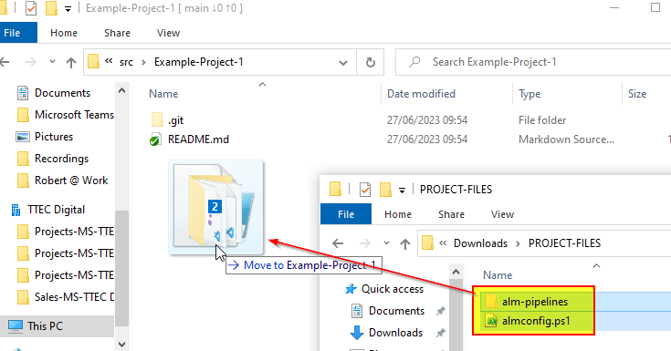

8) Back in VS Code, use the source control view to commit and sync the new files:

  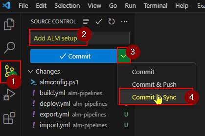

## Pipelines setup (Azure DevOps only)

|Name to use   |Pipeline path (simple mode)   |Pipeline path (advanced mode)   |
|-                |-             |- |
|EXPORT|`/alm-pipelines/export.yml`|`/alm-pipelines/export-advanced.yml`|
|IMPORT|`/alm-pipelines/import.yml`|`/alm-pipelines/import.yml`|
|BUILD|`/alm-pipelines/build.yml`|`/alm-pipelines/build-advanced.yml`|
|DEPLOY|`/alm-pipelines/deploy.yml`|`/alm-pipelines/deploy.yml`

[How to pick between simple mode and advanced mode?](/Background-Info/Simple-mode-vs-advanced-mode)

**For each of the pipelines listed above:**

1) Navigate to "Pipelines" and select the option to create a new pipeline:

  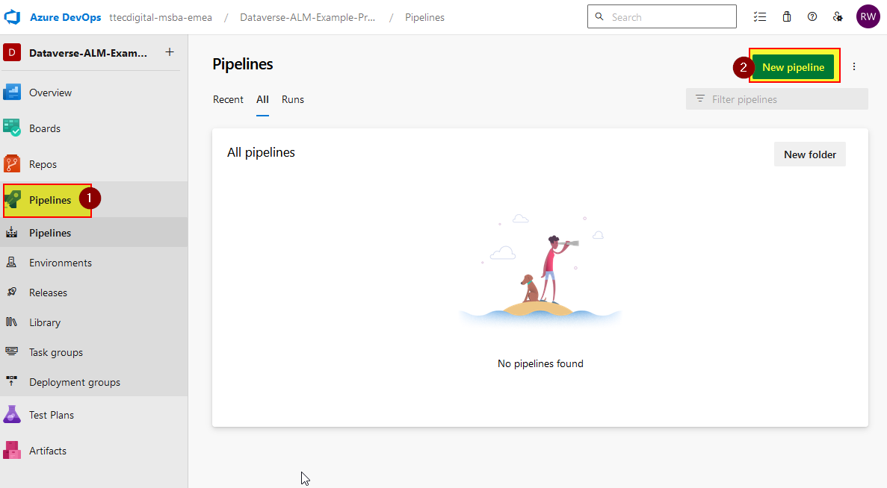

2) Select "Azure Repos Git":

  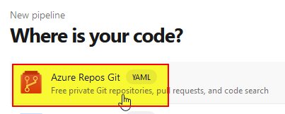

3) Select the target repo:

   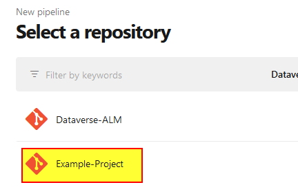

4) Select existing YAML file:

   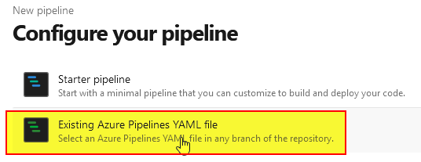

5) Select the 'main' branch and the path of the pipeline file from the table below:

    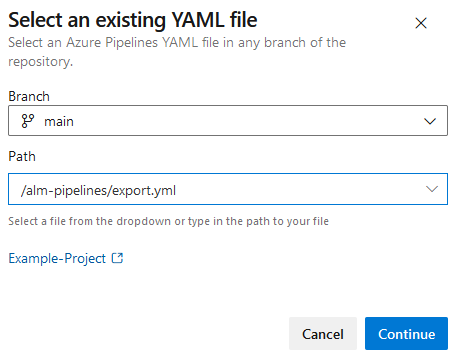

8) Save the pipeline:

   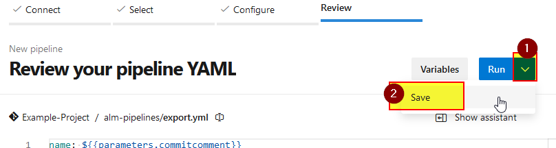

9) Give the pipeline the correct name (see table) by selecting the rename option:

  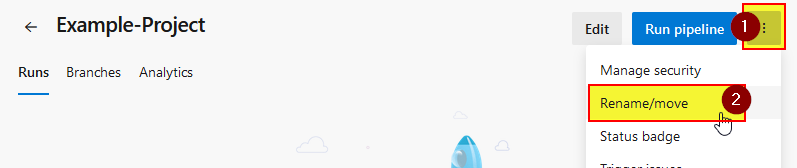

## What's next?

Complete the [Per Branch Setup](/Setup-and-Configuration/Per-Branch-Setup) for the first branch (usually called `main`) this includes setup for the environents for this branch.

Complete the [Per Solution/Component Setup](/Setup-and-Configuration/Per-Component-Setup) for each solution/component you want to include in the repo.
