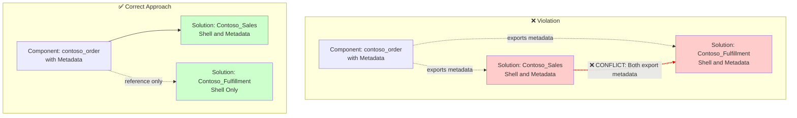

# ComponentInMoreThanOneUmanagedSolution-Metadata

## Overview

This validation rule detects when a component exists in more than one unmanaged solution with the "Shell and Metadata" (rootcomponentbehavior = 1) option enabled.

## Visual Representation

## Why This Matters

When the same component exists in multiple unmanaged solutions with "Shell and Metadata" enabled:

1. **Metadata Conflicts**: Both solutions will export the component's metadata, potentially creating inconsistent definitions
2. **Schema Drift**: Independent changes to metadata in different solutions can lead to divergent schemas
3. **Deployment Order Dependencies**: The order in which solutions are deployed affects the final metadata state
4. **Troubleshooting Difficulty**: Tracking down which solution introduced a metadata change becomes complex

## Component Behavior Types

| Behavior | Value | Description |
|----------|-------|-------------|
| Include Subcomponents | 0 | Exports the component and all its subcomponents (full export) |
| Shell and Metadata | 1 | Exports only the component shell and metadata |
| Shell Only | 2 | Exports only the component shell reference |

## Resolution

To resolve this issue:

1. **Consolidate metadata ownership**: Choose one solution to own the metadata definition
2. **Convert to Shell Only**: Change other solutions to use Shell Only (behavior = 2) to avoid exporting metadata
3. **Use Include Subcomponents strategically**: If one solution needs full control, use Include Subcomponents in that solution and Shell Only in others

## Example

An entity `contoso_order` has metadata exported in both:
- `Contoso_Sales` solution (Shell and Metadata)
- `Contoso_Fulfillment` solution (Shell and Metadata)

**Fix**: Designate `Contoso_Sales` as the metadata owner, and change `Contoso_Fulfillment` to Shell Only.

## Related Rules

- [ComponentInMoreThanOneUnmanagedSolution](ComponentInMoreThanOneUnmanagedSolution.md) - Same issue but for Include Subcomponents behavior
- [ComponentInMoreThanOneUmanagedSolution-NotShellOnly](ComponentInMoreThanOneUmanagedSolution-NotShellOnly.md) - Conflicting behaviors between solutions

## Additional Resources

- [Microsoft Docs: Solution component behavior](https://learn.microsoft.com/en-us/power-platform/alm/solution-concepts-alm)
- [Microsoft Docs: Add existing components to a solution](https://learn.microsoft.com/en-us/power-apps/maker/data-platform/use-solution-explorer#add-an-existing-component-to-a-solution)
