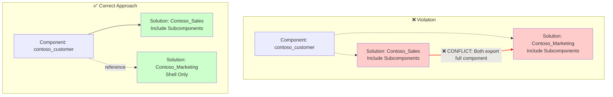

# ComponentInMoreThanOneUnmanagedSolution

## Overview

This validation rule detects when a component exists in more than one unmanaged solution with the "Include Subcomponents" (rootcomponentbehavior = 0) option enabled.

## Visual Representation

## Why This Matters

When the same component exists in multiple unmanaged solutions with "Include Subcomponents" enabled:

1. **Export Conflicts**: When either solution is exported, both will include the full component definition, potentially creating version conflicts
2. **Deployment Issues**: Deploying these solutions to different environments may result in inconsistent component states
3. **Merge Complexity**: When both solutions modify the component, it becomes difficult to determine which version should be authoritative
4. **ALM Anti-pattern**: This pattern violates the principle of single ownership for components in Dataverse

## Component Behavior Types

| Behavior | Value | Description |
|----------|-------|-------------|
| Include Subcomponents | 0 | Exports the component and all its subcomponents (full export) |
| Shell and Metadata | 1 | Exports only the component shell and metadata |
| Shell Only | 2 | Exports only the component shell reference |

## Resolution

To resolve this issue:

1. **Identify the authoritative solution**: Determine which solution should "own" the component
2. **Remove from other solutions**: Remove the component from all other unmanaged solutions, or change their behavior to "Shell Only" or "Shell and Metadata"
3. **Use solution layering**: For shared components, consider using a base solution that owns the component, with other solutions referencing it via Shell Only

## Example

A table `contoso_customer` exists in both:
- `Contoso_Sales` solution (Include Subcomponents)
- `Contoso_Marketing` solution (Include Subcomponents)

**Fix**: Keep the table in `Contoso_Sales` with Include Subcomponents, and change `Contoso_Marketing` to use Shell Only for this table.

## Related Rules

- [ComponentInMoreThanOneUmanagedSolution-Metadata](ComponentInMoreThanOneUmanagedSolution-Metadata.md) - Same issue but for Shell and Metadata behavior
- [ComponentInMoreThanOneUmanagedSolution-NotShellOnly](ComponentInMoreThanOneUmanagedSolution-NotShellOnly.md) - Conflicting behaviors between solutions

## Additional Resources

- [Microsoft Docs: Solution component behavior](https://learn.microsoft.com/en-us/power-platform/alm/solution-concepts-alm)
- [Microsoft Docs: Solution layers](https://learn.microsoft.com/en-us/power-platform/alm/solution-layers-alm)
