# ComponentIsUnmanagedNonCustom

## Overview

This validation rule detects when a solution contains out-of-box, unmodified system components that are added with **Include All** (behavior 0) or **Include Metadata** (behavior 1). It ensures that solutions only include components that are either:
- Custom components created specifically for your organization, OR
- System components that have been customized (have active customizations)

**Note:** Components added with **Shell Only** behavior (2) are excluded from this validation as they are metadata-only references.

## Visual Representation

```mermaid
graph TD
    subgraph "❌ Violation: Unmodified System Component"
        C1[Account Table<br/>System Component<br/>Behavior: 0 or 1]
        S1[Your Solution]
        C1 -->|"❌ Not custom<br/>No customizations<br/>Will be validated"| S1
        style C1 fill:#ffcccc
        style S1 fill:#ffcccc
    end
    
    subgraph "✅ Correct: Custom Component"
        C2[contoso_customer<br/>Custom Table<br/>Behavior: 0 or 1]
        S2[Your Solution]
        C2 -->|"✓ Custom component<br/>Passes validation"| S2
        style C2 fill:#ccffcc
        style S2 fill:#ccffcc
    end
    
    subgraph "✅ Correct: Customized Table Metadata"
        C3[Account Table<br/>Display Name Changed<br/>Behavior: 0 or 1]
        S3[Your Solution]
        C3 -->|"✓ Metadata customized<br/>Passes validation"| S3
        style C3 fill:#ccffcc
        style S3 fill:#ccffcc
    end
    
    subgraph "⏭️ Excluded: Shell-Only Component"
        C4[Account Table<br/>Shell Only<br/>Behavior: 2]
        S4[Your Solution]
        C4 -->|"⏭️ Not validated<br/>Metadata reference only"| S4
        style C4 fill:#e0e0e0
        style S4 fill:#e0e0e0
    end
```



## Why This Matters

Including unmodified, out-of-box system components in your solutions creates several issues:

1. **Deployment Bloat**: System components are already present in all environments, so including them unnecessarily increases solution size
2. **Maintenance Overhead**: Future updates to system components may conflict with your solution
3. **Solution Complexity**: Makes it harder to understand what your solution actually customizes
4. **ALM Best Practice**: Solutions should contain only your organization's customizations, not base platform components
5. **Dependency Management**: Creates unnecessary dependencies on system components

**Note:** This rule does not apply to components added with **Shell Only** behavior (behavior = 2). Shell-only components include only the metadata reference without subcomponents, which is a valid pattern for dependencies.

## Component Behavior

When adding components to solutions, you can specify a behavior that controls what gets included:

| Behavior Value | Name | Description | Validation |
|----------------|------|-------------|------------|
| **0** (or NULL) | Include All (Include Subcomponents) | Includes the component and all its subcomponents | ✅ Validated |
| **1** | Do Not Include Subcomponents (Shell and Metadata) | Includes the component and metadata but excludes subcomponents | ✅ Validated |
| **2** | Shell Only | Only metadata reference, no actual customizations | ⏭️ **Skipped** |

**Important:** This validation rule **excludes shell-only components** (behavior = 2) because they represent metadata references, not actual customizations.

## Component Classification

Components are classified based on two key properties:

| Property | Description |
|----------|-------------|
| **msdyn_iscustom** | Indicates if the component was created by your organization (not part of the base system) |
| **msdyn_hasactivecustomization** | Indicates if the component's own metadata has been customized (e.g., display name changed, properties modified). **Note:** Adding/modifying subcomponents does NOT mark the parent as customized. |

### Valid Scenarios

A component is valid in your solution if **any** of these is true:
- ✅ `msdyn_iscustom = true` - Custom component you created
- ✅ `msdyn_hasactivecustomization = true` - Component metadata you customized
- ✅ `rootcomponentbehavior = 2` - Shell-only component (metadata reference only)

### Invalid Scenario

A component violates this rule if **all** of these are true:
- ❌ `msdyn_iscustom ≠ true` - Not a custom component
- ❌ `msdyn_hasactivecustomization ≠ true` - No active customizations
- ❌ `rootcomponentbehavior ≠ 2` - Not a shell-only reference

## Examples

### ❌ Violation Examples

```powershell
# Adding the unmodified Account table to your solution
Set-DataverseSolutionComponent -SolutionName "MySolution" `
    -ComponentId $accountEntityId -ComponentType 1 -Behavior 0

# The Account table is a system component with no customizations
# This will trigger the validation rule
```

### ✅ Correct Examples

```powershell
# Example 1: Adding a custom table
Set-DataverseSolutionComponent -SolutionName "MySolution" `
    -ComponentId $customTableId -ComponentType 1 -Behavior 0
# Custom tables (contoso_*, etc.) are valid

# Example 2: Adding a custom field to Account table
# Add only the custom field (subcomponent), not the Account table itself
Set-DataverseSolutionComponent -SolutionName "MySolution" `
    -ComponentId $customFieldId -ComponentType 2 -Behavior 0
# The custom field (msdyn_iscustom = true) is valid
# The Account table itself should NOT be included unless its metadata was modified

# Example 3: Adding Account table with modified metadata
# If you've changed the Account table's display name, description, or other metadata
Set-DataverseSolutionComponent -SolutionName "MySolution" `
    -ComponentId $accountEntityId -ComponentType 1 -Behavior 0
# This is valid because the table's metadata was modified (msdyn_hasactivecustomization = true)

# Example 4: Adding Account table as shell-only (valid for dependencies)
Set-DataverseSolutionComponent -SolutionName "MySolution" `
    -ComponentId $accountEntityId -ComponentType 1 -Behavior 2
# Behavior 2 = ShellOnly - only metadata reference, no subcomponents
# This is valid and bypasses the validation rule
```

## Technical Implementation

This validation rule queries both the `solutioncomponent` table and the `msdyn_solutioncomponentsummary` virtual table to inspect all components including subcomponents.

### Query Approach

```powershell
# Step 1: Get all components from solutioncomponent table (includes subcomponents)
$components = Invoke-DataverseSQL -Sql "
    SELECT sc.objectid, sc.componenttype, sc.rootsolutioncomponentid
    FROM solutioncomponent sc
    INNER JOIN solution s ON sc.solutionid = s.solutionid
    WHERE s.uniquename = @solutionname"

# Step 2: For each component, query the summary table for metadata
foreach ($component in $components) {
    $summary = Invoke-DataverseRequest -Method Get -Path "
        msdyn_solutioncomponentsummaries?
        `$filter=msdyn_solutionid eq $solutionId 
            and msdyn_componenttype eq $componentType 
            and msdyn_objectid eq $componentId"
    
    # Step 3: Check if component is custom or has customizations
    if ($summary.msdyn_iscustom -ne $true -and 
        $summary.msdyn_hasactivecustomization -ne $true) {
        # Report violation
    }
}
```

This approach allows validation of:
- **Root components**: Tables, Workflows, Web Resources, etc.
- **Subcomponents**: Columns, Forms, Views, Charts, etc.
- **All component types** supported by the solution component summary table

## Validated Component Types

This rule validates all component types including:

### Root Components
- Tables (Entities)
- Workflows (Processes)
- Web Resources
- Security Roles
- Plugins and Custom APIs
- Environment Variable Definitions
- Canvas Apps
- Model-driven Apps

### Subcomponents ✨ NEW
- **Columns (Attributes)** - Including lookups, calculated fields, etc.
- **Forms** - Main forms, quick view forms, quick create forms
- **Views** - System views and user views
- **Charts and Dashboards**
- **Business Rules**
- **Keys and Relationships**
- Other metadata components

## How to Fix Violations

If you encounter this violation, you have several options:

### Option 1: Remove the Component (Recommended)
If the component is truly unmodified and not needed, remove it from your solution:

```powershell
Remove-DataverseSolutionComponent -SolutionName "MySolution" `
    -ComponentId $componentId -ComponentType $componentType
```

### Option 2: Verify Actual Customization
If you believe the component should be in the solution:
1. **For parent components (tables, etc.)**: Verify that the component's own metadata was actually modified (display name, description, properties, etc.)
2. **For subcomponents**: Add only the custom/modified subcomponents (fields, forms, views), not their parent table
3. **Important**: Adding custom fields to a table does NOT make the table itself customized - only include the table if its own metadata was changed

### Option 3: Suppress for Specific Components
If there's a valid business reason to include the unmodified component, you can suppress this validation for specific components in `alm-config.psd1`:

```powershell
# In alm-config.psd1 under solution configuration:
skipValidationRules = @(
    @{
        ruleName = 'ComponentIsUnmanagedNonCustom'
        componentId = '00000000-0000-0000-0000-000000000000'  # Specific component
        mode = 'skip'  # or 'warning'
    },
    @{
        ruleName = 'ComponentIsUnmanagedNonCustom'
        componentType = 1  # All entities
        mode = 'warning'
    }
)
```

## Common Scenarios

### Scenario 1: System Tables with Custom Fields
**Invalid for the Table** ❌ - If you add custom fields to a system table like Account or Contact, the **custom fields** themselves are valid and should be included in your solution, but the **Account/Contact table itself** should NOT be included unless you've also modified the table's own metadata (display name, description, etc.). Adding custom fields does NOT mark the parent table as customized.

### Scenario 2: Referenced System Tables
**Invalid** ❌ - If you add a lookup to Contact from your custom table, don't add the Contact table itself unless you've modified the table's metadata. The lookup field (relationship) should be included as it's custom, but the Contact table is a dependency that will be resolved automatically.

### Scenario 3: Security Roles
**Check Carefully** - System security roles should only be included if you've customized them. Create custom security roles instead when possible.

### Scenario 4: Dependencies
**Consider Carefully** - Just because a component is a dependency doesn't mean it should be in your solution. Dependencies are resolved at import time.

### Scenario 5: Shell-Only Components
**Valid** ✅ - Components added with behavior = 2 (Shell Only) are excluded from this validation. Shell-only is typically used for dependency references where you only need the metadata, not the full component and subcomponents. This is a valid ALM pattern for certain scenarios.

## Related Rules

- **ComponentInMoreThanOneUnmanagedSolution**: Prevents component ownership conflicts
- **ComponentSchemaNamePrefixDoesNotMatchPublisherPrefix**: Ensures naming consistency
- **SolutionUsesSystemPublisher**: Validates publisher configuration

## References

- [Microsoft Learn: Solution concepts](https://learn.microsoft.com/power-platform/alm/solution-concepts-alm)
- [Microsoft Learn: Healthy ALM practices](https://learn.microsoft.com/power-apps/maker/data-platform/solutions-overview)
- [msdyn_solutioncomponentsummary table reference](https://learn.microsoft.com/power-apps/developer/data-platform/reference/entities/msdyn_solutioncomponentsummary)
