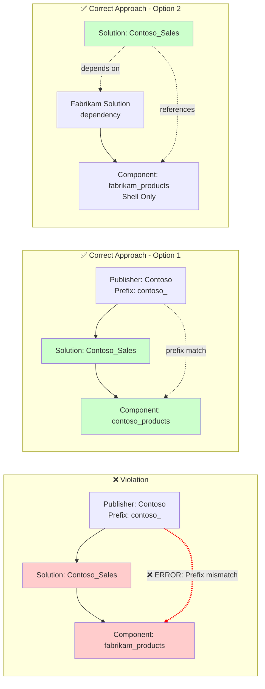

# ComponentSchemaNamePrefixDoesNotMatchPublisherPrefix

## Overview

This validation rule detects when a component's schema name prefix doesn't match the publisher prefix of the solution it's in. This typically indicates that a component created by a different publisher has been added to your solution.

## Visual Representation

## Why This Matters

1. **Publisher Ownership**: Components should typically be owned by the publisher that created them. Including components from other publishers in your solution can create ALM complications.

2. **Upgrade Issues**: When you deploy a managed solution, components with mismatched prefixes may conflict with their original publisher's solution.

3. **Dependency Clarity**: Mismatched prefixes make it unclear which solution/publisher is responsible for maintaining the component.

4. **Customization Lock**: Microsoft and ISV components (with different prefixes) may be locked and cannot be modified, causing deployment failures.

## Excluded Component Types

The following component types are excluded from this rule because they commonly don't follow prefix conventions or are system-managed:

| Type Code | Component Type |
|-----------|---------------|
| 3 | Option Set (Global) |
| 10 | Entity Relationship |
| 61 | Web Resource |
| 92 | SDK Message Processing Step Image |
| 300 | Canvas App |
| 10044 | (Reserved) |

## Resolution

To resolve this issue:

1. **Remove foreign components**: If the component belongs to another publisher, remove it from your solution and add a dependency instead
2. **Re-create with correct prefix**: If you need ownership of the component, create a new one with your publisher's prefix and migrate data/functionality
3. **Add as Shell Only**: If you only need to reference the component, add it as Shell Only to avoid ownership conflicts
4. **Verify solution segmentation**: Ensure your ALM strategy properly segments owned vs. referenced components

## Example

Solution `Contoso_Sales` uses publisher prefix `contoso_`.
The solution contains a table `fabrikam_products` (prefix `fabrikam_`).

**Problem**: The table belongs to a different publisher (Fabrikam) but is being exported in your solution.

**Resolution Options**:
1. Remove `fabrikam_products` from your solution and add a solution dependency on the Fabrikam solution
2. If you need to own this component, create `contoso_products` and migrate

## Related Rules

- [SolutionUsesSystemPublisher](SolutionUsesSystemPublisher.md) - Solution using system-created publisher

## Additional Resources

- [Microsoft Docs: Solution publisher](https://learn.microsoft.com/en-us/power-platform/alm/solution-concepts-alm#solution-publisher)
- [Microsoft Docs: Create a solution publisher](https://learn.microsoft.com/en-us/power-apps/maker/data-platform/create-solution#create-a-solution-publisher)
