````markdown
# DependencyOnSolutionNotAllowed

## Overview

This validation rule detects when your solution has dependencies on components from solutions that are not in your approved list of valid dependency solutions. This helps enforce a controlled dependency architecture and prevents unexpected coupling between solutions.

## Visual Representation

```mermaid
graph TD
    subgraph "❌ Violation - Unapproved Dependency"
        YourSol1[Your Solution:<br/>Contoso_Sales]
        YourComp1[Your Component:<br/>Sales Workflow]
        UnapprovedSol[Unapproved Solution:<br/>Fabrikam_Integration]
        UnapprovedComp[Required Component:<br/>Integration Plugin]
        
        YourSol1 --> YourComp1
        YourComp1 -.depends on.-> UnapprovedComp
        UnapprovedSol --> UnapprovedComp
        YourSol1 -."❌ ERROR: Not in approved list".-> UnapprovedSol
    end
    
    subgraph "✅ Correct Approach - Option 1: Approved Dependency"
        YourSol2[Your Solution:<br/>Contoso_Sales]
        YourComp2[Your Component:<br/>Sales Workflow]
        ApprovedSol[Approved Solution:<br/>Contoso_Core]
        ApprovedComp[Required Component:<br/>Core Plugin]
        
        YourSol2 --> YourComp2
        YourComp2 -.depends on.-> ApprovedComp
        ApprovedSol --> ApprovedComp
        YourSol2 -.approved.-> ApprovedSol
    end
    
    subgraph "✅ Correct Approach - Option 2: Include Component"
        YourSol3[Your Solution:<br/>Contoso_Sales]
        YourComp3[Your Component:<br/>Sales Workflow]
        IncludedComp[Included Component:<br/>Integration Plugin]
        
        YourSol3 --> YourComp3
        YourSol3 --> IncludedComp
        YourComp3 -.uses.-> IncludedComp
    end
    
    style YourSol1 fill:#ffcccc
    style UnapprovedSol fill:#ffcccc
    style YourSol2 fill:#ccffcc
    style ApprovedSol fill:#ccffcc
    style YourSol3 fill:#ccffcc
    linkStyle 3 stroke:#ff0000,stroke-width:3px
```



## Why This Matters

1. **Deployment Order Control**: Unknown dependencies can cause deployment failures if the dependent solution isn't deployed first
2. **Environment Consistency**: Dependencies on unapproved solutions may not exist in all target environments
3. **Version Compatibility**: Unapproved dependencies may introduce version conflicts during upgrades
4. **ALM Governance**: A clear dependency tree is essential for predictable application lifecycle management
5. **Isolation**: Solutions should only depend on explicitly approved shared components

## How Dependencies Are Detected

The rule uses the Dataverse `dependency` table to find:
1. Components in your solution that require other components to function
2. Required components that are NOT in your solution (with Include Subcomponents)
3. Solutions containing those required components

The rule then checks if those solutions are in your `validdependencysolutionnames` list.

## Configuration

Set your valid dependencies in your ALM configuration:

```powershell
@{
    validdependencysolutionnames = @(
        "Contoso_Core",
        "Contoso_Shared",
        "msdyn_*"  # Wildcards supported
    )
    ignoresolutionnames = @(
        "Default"
    )
}
```

An `Active` base solution is not a deployable dependency solution. For an `Active`-based dependency, the rule resolves the required component's membership in other solutions and applies the usual allowed-dependency checks to those solution names. This catches dependencies on components owned by a solution that has not yet been processed or is not allowed. If a required table is present only with `Include table metadata` (`rootcomponentbehavior = 1`) and no complete solution contains it, the finding reports `<Not in any solution>`; remove the table and add it again with `Include all objects`. `Active` can still be added to `ignoresolutionnames` to suppress this check intentionally.

When the component-owning solution is present in the configured solution list but appears later than the solution being validated, the finding identifies that ordering as invalid: a solution cannot depend on components in a solution that appears later in the configured order.

## Resolution

To resolve this issue:

1. **Add to approved list**: If the dependency is intentional, add the solution name to `validdependencysolutionnames`
2. **Include the component**: Add the required component to your solution to eliminate the external dependency
3. **Remove the dependent component**: If the dependency is unintentional, remove the component that causes it
4. **Restructure solutions**: Consider refactoring your solution architecture to properly layer dependencies

## Example

Your solution `Contoso_Sales` depends on a workflow in `Fabrikam_Integration`.
`Fabrikam_Integration` is not in your `validdependencysolutionnames`.

**Problem**: Deploying `Contoso_Sales` will fail unless `Fabrikam_Integration` is already present.

**Resolution Options**:
1. Add `Fabrikam_Integration` to your valid dependencies list
2. Include the required workflow in your solution
3. Remove the component that depends on the Fabrikam workflow

## Dependency Information Shown

The error output includes:
- **SolutionName**: The solution containing the required component
- **ComponentId**: The ID of the required component
- **ComponentType**: The type of the required component
- **ComponentSchemaName**: The schema name of the required component
- **DependentComponentSchemaName**: Your component that has the dependency
- **DependentComponentParentName**: Parent table/entity if applicable

## Related Rules

- [ComponentSchemaNamePrefixDoesNotMatchPublisherPrefix](ComponentSchemaNamePrefixDoesNotMatchPublisherPrefix.md) - Foreign components in your solution

## Additional Resources

- [Microsoft Docs: Solution dependencies](https://learn.microsoft.com/en-us/power-platform/alm/solution-concepts-alm#solution-dependencies)
- [Microsoft Docs: View dependencies for a solution](https://learn.microsoft.com/en-us/power-apps/maker/data-platform/view-component-dependencies)
````