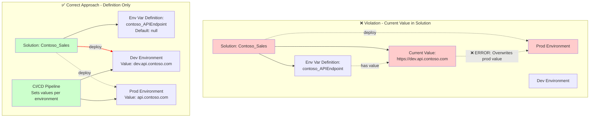

````markdown
# EnvironmentVariableCurrentValueInSolution

## Overview

This validation rule detects when an Environment Variable **Current Value** (component type 381) is included in your solution. Current values should be excluded from solutions because they are environment-specific.

## Visual Representation



## Why This Matters

Environment Variables have two components:
- **Definition** (type 380): The schema, default value, and metadata - SHOULD be in solutions
- **Current Value** (type 381): The actual value used at runtime - Should NOT be in solutions

Including current values in solutions causes problems:

1. **Environment-Specific Values Overwritten**: Deploying the solution will overwrite the current value in the target environment with the value from development
2. **Connection Strings Leaked**: Sensitive values like connection strings may be exported and deployed to wrong environments
3. **Configuration Drift**: Target environment configurations are unexpectedly changed
4. **ALM Anti-pattern**: Current values should be set per-environment, not transported in solutions

## Resolution

To resolve this issue:

1. **Remove current value from solution**:
   - In the Power Apps maker portal, go to your solution
   - Find the Environment Variable Definition
   - Expand it to see the Current Value
   - Select the Current Value and click "Remove" (not delete)

2. **Set values per environment**:
   - Use Azure DevOps/GitHub pipeline variables
   - Use environment-specific configuration files
   - Set values manually in each environment after deployment
   - Use Power Platform Environment Variables API during deployment

3. **Use Default Values**: If appropriate, set a sensible default value in the Definition that works across environments

## Example

Your solution contains:
- `contoso_APIEndpoint` (Environment Variable Definition) ✓
- `contoso_APIEndpoint` Current Value = "https://dev.api.contoso.com" ✗

**Problem**: Deploying to production will set the API endpoint to the dev URL.

**Fix**: Remove the current value from the solution. Set the current value via deployment pipeline:

```powershell
# In your deployment script
Set-DataverseEnvironmentVariable -Name "contoso_APIEndpoint" -Value $env:API_ENDPOINT
```

## Pipeline Integration

Configure your CI/CD pipeline to set environment variable values:

```yaml
# Azure DevOps example
- task: PowerShell@2
  inputs:
    targetType: 'inline'
    script: |
      # Set environment variable after solution deployment
      pac env variable set --name contoso_APIEndpoint --value $(ApiEndpoint)
```

## Related Rules

None directly related.

## Additional Resources

- [Microsoft Docs: Environment variables overview](https://learn.microsoft.com/en-us/power-apps/maker/data-platform/environmentvariables)
- [Microsoft Docs: Use environment variables in solutions](https://learn.microsoft.com/en-us/power-apps/maker/data-platform/environmentvariables-solution)
- [Microsoft Docs: Set environment variable values during deployment](https://learn.microsoft.com/en-us/power-platform/alm/environment-variables-build-tools)
````